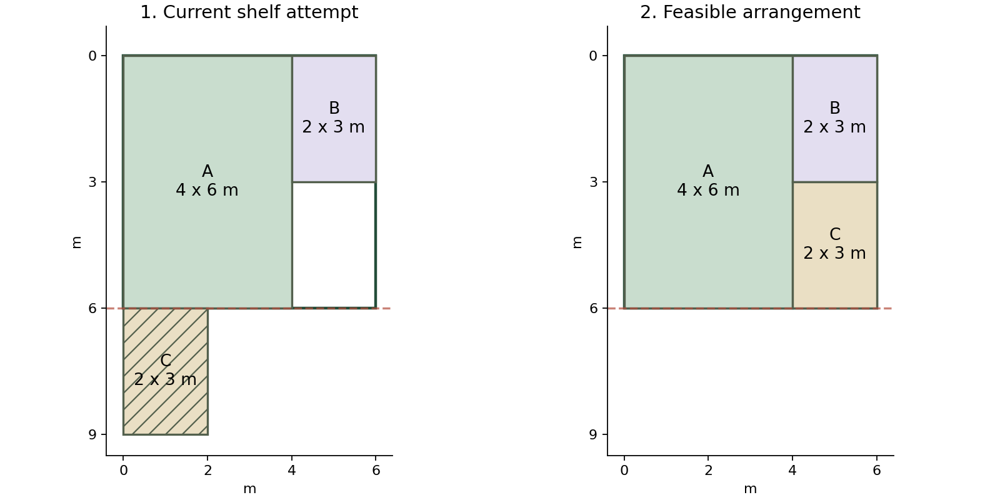

# مراجعة فعالية وجودة مولّد «أنت المهندس»

تاريخ الفحص: 17 أكتوبر 2026. النسخة المفحوصة: commit `1c045e25bdc923b21fd59582ef57dd2b922992c8`. لم يُعدّل محرك التوليد ولم يُنشر التطبيق أثناء المراجعة.

## الحكم

المحرك الحالي مناسب لعرض **مستطيلات الغرف وتجربة أبعادها**، لكنه لا يكفي لتوليد مخطط معماري جيد. توجد فجوة مثبتة في البحث عن توزيع ممكن، بالإضافة إلى غياب نمذجة الحركة والخصوصية والفتحات والجدران. نجاح التشغيل أو تنزيل ملف لا يثبت صلاحية المخطط للسكن أو التنفيذ.

## ما اختُبر وما ظهر

| الفحص | النتيجة | دلالتها وحدودها |
|---|---|---|
| اختبارات التطبيق الموجودة | 5 ناجحة | واجهة الخدمة والاستيراد والتوليد والتنزيل والتحقق الأساسي تعمل في الحالات المختبرة |
| 1,200 برنامج غرف عشوائي ببذرة ثابتة | قُبل 118 ورُفض 1,082 | البرامج ليست جميعها قابلة للحل؛ لا يجوز تفسير هذا كنسبة نجاح للمحرك |
| فحص التوزيعات العشوائية المقبولة الـ118 | لم يُرصد تداخل أو خروج عن الأرض أو تغيير أبعاد أو فقد غرف | سلامة هندسية للمستطيلات في هذه العينة فقط، بسماحية 0.0000001 متر |
| 300 حالة اصطناعية نعرف مسبقًا توزيعًا صالحًا لكل منها | قُبل 64 ورُفض 236، أي 78.7% رفض خاطئ في هذه العينة | بُنيت بتقسيم الأرض إلى مستطيلات تملؤها تمامًا، دون جدران أو ممرات. ليست تمثيلًا إحصائيًا للمشاريع الواقعية |
| تغيير ترتيب المدخلات عند تساوي الأعماق | نفس الغرف قُبلت بترتيب ورُفضت بترتيب آخر | النتيجة تتأثر بترتيب الإدخال |
| تبديل أنواع الغرف من نوم إلى حمامات | الإحداثيات نفسها | نوع الغرفة لا يوجّه التوزيع، ولا يضيف متطلبات معمارية |
| أرض 9×9 م، تسع غرف نوم 3×3 م | قُبلت غرفة مركزية بلا تماس مع حدود الأرض | لا يوجد فحص فعلي لفتحاتها أو وصولها؛ التماس مع الحد وحده لا يثبت التهوية أيضًا |
| تصدير DXF لتوزيع التسع غرف | الوحدات أمتار، 9 مستطيلات غرف، لا اختلافات إحداثيات أو أخطاء في فاحص ezdxf | لم يُختبر الملف داخل AutoCAD أو برنامج CAD مستقل |
| تصدير PDF للعينة | يُفتح ويُرسم؛ ظهر فقد الحرف اللاتيني R من أسماء R1 إلى R9 في صورة الصفحة | خط تسميات الغرف لا يغطي الأحرف اللاتينية المستخدمة؛ يلزم دعم خطوط بديلة أو نص مختلط. الملف ليس لوحة تنفيذية |

## مثال فشل قابل للتحقق يدويًا

الأرض **6×6 م**، والغرف **A: 4×6 م، B: 2×3 م، C: 2×3 م**.

مساحة الغرف 36 م² تساوي مساحة الأرض. يوجد توزيع صحيح: A في اليسار، وB وC فوق بعضهما في شريط عرضه متران إلى اليمين. المحرك يضع A وB في صف بارتفاع 6 م، ثم يحاول وضع C أسفل الصف خارج الأرض ويرفض الطلب.



هذا المثال يثبت أن رسالة «لا تتسع وفق الترتيب التجريبي» لا تعني استحالة وجود حل. التجربة لا تتطلب تدوير أي غرفة.

مثال أثر ترتيب المدخلات: أرض 10×4 م، وغرفتان 6×2 م وغرفتان 4×2 م. ترتيب 6،6،4،4 يُرفض؛ ترتيب 6،4،6،4 يُقبل، مع بقاء الأبعاد نفسها.

## تقييم الجودة المعمارية

- **الوصول والحركة:** لا تُنمذج مداخل أو أبواب أو ممرات أو إمكانية الوصول إلى كل غرفة.
- **الخصوصية والعلاقات:** لا يوجد فصل ضيوف وعائلة أو تقييم تجاوز غرف النوم أو علاقة المطبخ بالطعام.
- **التهوية والإضاءة:** لا توجد نوافذ أو واجهات محددة أو مناور أو حسابات تحقق.
- **الجدران:** الغرف مستطيلات متلاصقة دون سماكات؛ امتلاء الأرض بها لا يترك بالضرورة مساحة لإنشاء جدران أو ممرات.
- **الموقع:** لا تُدخل ارتدادات أو موقع الشارع والمدخل أو اتجاه شمال حقيقي أو اشتراطات محلية معتمدة.
- **البدائل:** المحرك حتمي ويعيد توزيعًا واحدًا ولا يقارن جودة حلول متعددة.
- **نتائج الفحص:** علامة PASS الحالية تعني وجود غرف في البرنامج فقط. بنود العمارة PENDING ثابتة، وليست اختبارات تحقق منفّذة.

لا يمكن منح المخطط درجة جودة معمارية موثوقة من هذا النظام الحالي؛ معايير التقييم ومدخلاتها لم تُنفّذ بعد.

## الأولويات المقترحة للتحسين

1. تحسين البحث عن توزيع ممكن: استغلال الفراغات المتبقية، وتجربة ترتيبات متعددة، ودوران الغرف فقط إن سمح المستخدم به. لا يُعلن الاستحالة لمجرد فشل محاولة واحدة.
2. إضافة تمثيل واضح للجدران والمداخل والأبواب والممرات، والتحقق من وصول جميع الغرف من المدخل دون المرور غير المقصود بالغرف الخاصة.
3. إدخال متطلبات المشروع: حدود الأرض والارتدادات والشارع والاتجاه وعلاقات الغرف والخصوصية والواجهات المتاحة للفتحات. تُحدَّد القواعد المحلية من مصادر معتمدة.
4. مقارنة بدائل وفق معايير معلنة، وإظهار القيود التي نجحت والتي فشلت والتي لم يُتحقق منها.
5. اختبار مشاريع واقعية بمرجع مخططات يراجعه معماري، والتحقق من ملفات CAD في برنامج مستقل.

تحسين تعبئة المستطيلات وحده لا يحقق هذه البنود المعمارية.

## إعادة الفحص

من جذر المستودع مع تفعيل بيئة Python وتثبيت requirements.txt:

```bash
python -m pytest -q
python -m quality_review.evaluate
```

التقييم يستخدم بذرة ثابتة `20261017`. يكتب results.json والبرامج المرفوضة مع إحداثيات توزيع صالح في tiling_failures.json، ويحفظ ملفات تصدير العينة في exports/. زمن التشغيل الدقيق ومعرّفات الملفات يتغيران بين التشغيلات. التقرير والرسم مرفقان محليًا؛ لم أرفع تغييرات إلى GitHub ضمن هذه المراجعة.
