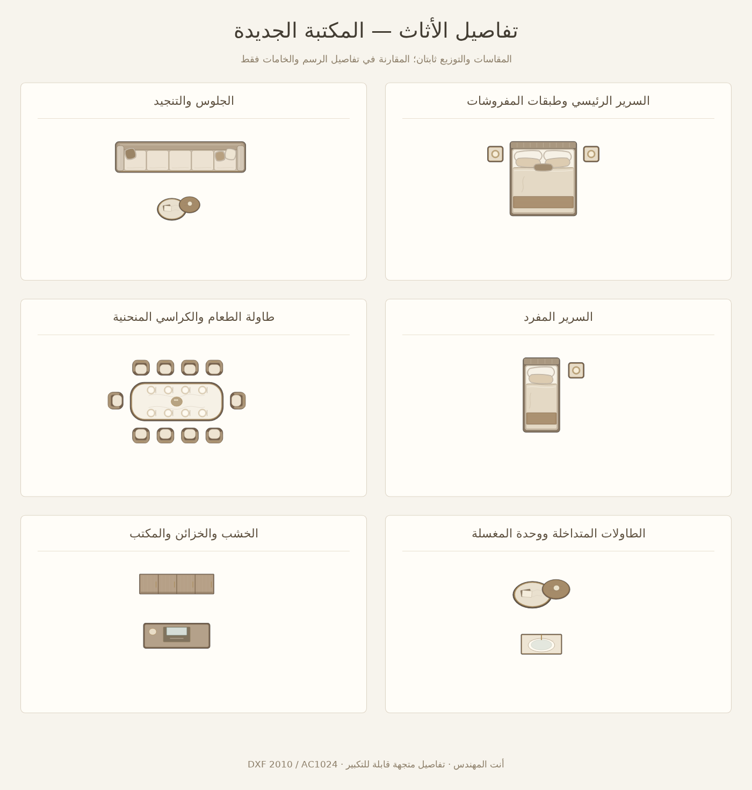

# مراجعة الأثاث V0.4.1

هذه أمثلة مراجعة محفوظة من نفس النموذج الهندسي، وليست ملفات تشغيل التطبيق. أول صفحة في furniture-before-after.pdf تعرض الرموز السابقة، والثانية تعرض الجديدة بالمقاسات نفسها. لم تُغير مواقع الفراغات أو الأبواب أو النوافذ أو أغلفة الأثاث أو السعة.

فُحصت الهوية الهندسية مقارنة بالنسخة السابقة بعد استبعاد معرفات المراجعات، ونجحت 37 حالة اختبار للتطبيق، منها احتواء رموز الأثاث الجديدة داخل الأغلفة عند الدورانات المستخدمة. لكل بديل افتراضي ما زالت هناك 35 نتيجة هندسية: 24 ناجحة جزئيًا و11 معلقة.

DXF محفوظ بإصدار AutoCAD 2010؛ إعادة فتحه أثبتت AC1024 والوحدات المترية وصفر أخطاء تدقيق ezdxf. لم يُفتح في AutoCAD مستقل. التفاصيل المتجهة لا تعني اعتمادًا نهائيًا لجودة الأثاث؛ اللوحة مخصصة لتقييم المستخدم.

ملفات JSON وSVG وPDF وDXF في هذا المجلد مرتبطة بالمراجعة نفسها. إعادة إنتاجها: `python -m quality_review.export_furniture_review`.

